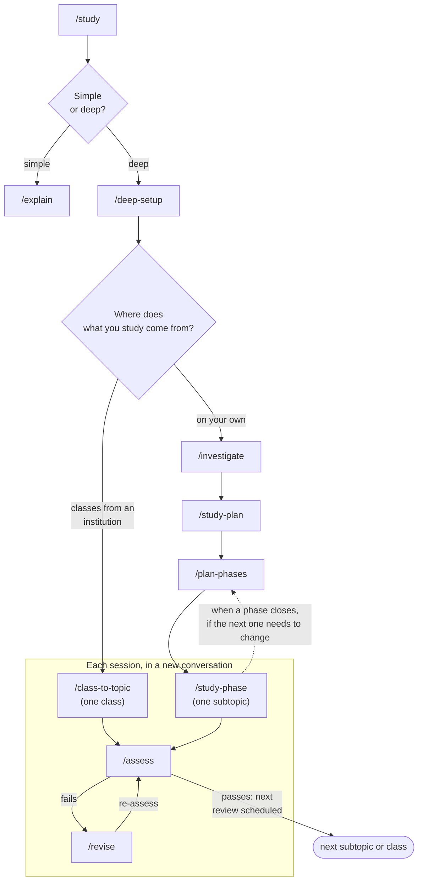

# study-skills

A Spanish version also exists: https://github.com/ruben-salas20/estudio-skills

Skills for studying with an AI agent. You tell it what you want to learn, and the agent researches it, builds a plan, writes study pages, assesses you, and schedules reviews. Over time, the system learns how you learn and proposes changes to teach you better.

It works for two kinds of study:

- **On your own:** the agent looks for reliable sources and teaches with them.
- **Classes from an institution:** the source is the class. The agent turns the transcript or your notes into study pages.

## Installation

You need an agent that uses skills and can launch subagents, such as [Claude Code](https://claude.com/claude-code).

There are two ways to install. Use only one: with both, every skill shows up twice.

### As a Claude Code plugin

1. In Claude Code, type:

   ```
   /plugin install study --marketplace ruben-salas20/study-skills
   ```

   Before Claude Code 2.1.275, it takes two commands: `/plugin marketplace add ruben-salas20/study-skills` and then `/plugin install study@study-skills`.

2. Type `/study:setup-study-skills`. It asks how you like to learn and where your study folder is, and writes your `AGENTS.md`.

With the plugin, every command starts with `study:`: `/study` is `/study:study`. The rest of this README writes them without that prefix.

**To update,** run `claude plugin update study@study-skills` in the terminal, reopen Claude Code, and type `/study:setup-study-skills`. You can also turn on auto-update in `/plugin`, under **Marketplaces**.

### With npx, in Claude Code and other agents

You need Node.js.

1. Install all the skills:

   ```
   npx skills add ruben-salas20/study-skills -g
   ```

2. Open your agent and type `/setup-study-skills`. It asks how you like to learn and where your study folder is, and writes your `AGENTS.md`.

Install all the skills: they use each other, and if one is missing, the flow breaks. Only `/create-kit` is optional.

**To update,** run `npx skills update -g` and then `/setup-study-skills`.

`npx skills` sends anonymous usage statistics to [skills.sh](https://skills.sh). To turn them off, add `DO_NOT_TRACK=1` before the command.

<details>
<summary>Manual installation, without npx</summary>

Clone this repository and copy each folder in `skills/` to your agent's skills folder (in Claude Code, `~/.claude/skills/`). Then type `/setup-study-skills`.

</details>

### For both ways

`/3d-scenes` and `/videos` need **Chromium or Chrome** to check what they do. `/videos` also needs **Node, Playwright, and ffmpeg** only if you ask for an MP4 or a video with voice.

Each update overwrites the skills. Setup reapplies the improvements you approved, saved in `IMPROVEMENTS.md`.

## How to use it



Start with `/study`. It asks what you want to learn and why, and picks the path with you. If you fail twice in a row, the page is rewritten from a different angle. If you don't know what to do next, type `/study-guide`: it checks how your study is going and tells you the next step. It also answers questions about the flow, for example `/study-guide how do I change the plan?`

| Skill | What it does |
|---|---|
| `/setup-study-skills` | Configures the skills to match how you like to learn. Used after installing and after each update. |
| `/study-guide` | Tells you what to do now, or explains a skill or the flow. |
| `/study` | Clarifies what you want to learn and whether a quick explanation is enough or a deep study is needed. |
| `/explain` | Explains something as text, diagram, HTML, or video. Also works outside your study folder. |
| `/deep-setup` | Creates the course folder, its index, `MISSION.md`, and `NOTES.md`. |
| `/class-to-topic` | Turns class material into topic pages, one per concept, and you study them. |
| `/investigate` | A subagent researches the topic while the agent checks what you already know. |
| `/study-plan` | Writes `PLAN.md`: the tree of phases and subtopics, with what's pending and what's mastered. |
| `/plan-phases` | Details each phase and redesigns it as you progress. |
| `/study-phase` | One study session: writes the subtopic page, you study it, and you're assessed. |
| `/assess` | Assesses you with questions and an exercise, and schedules the next review. |
| `/revise` | Reviews only what you got wrong, with hints from least to most. |
| `/improve-study` | Reviews your results and proposes changes to the system, with data. |
| `/create-kit` | Optional. Creates your kit of HTML pages with your colors and only the components you need. |
| `/3d-scenes` | Makes 3D scenes with Three.js that move and can be touched, embedded in the study pages. Needs Chromium or Chrome. |
| `/videos` | Makes animated explainer videos with code, with music and optional voice, embedded in the study pages. Needs Chromium or Chrome. |

`/class-to-topic` and `/study-phase` are started in a new session, so each session covers a single topic.

## What is saved in your study folder

| File | What it stores |
|---|---|
| `AGENTS.md` | How you want to be taught. The setup writes it. |
| `NOTES.md` | What the system learns about how you learn: one general and one per course. |
| `MISSION.md` | What you're studying, why, and what success looks like. |
| `BASELINE.md` | What you already knew when you started, checked with questions. |
| `PLAN.md` and `phases/` | The plan and the detail of each phase, with its changes. |
| `Topics/` | One page per concept. |
| `Resources/` | The sources, summarized and linked. |
| `Assessments/log.md` | One line per assessment. |
| `IMPROVEMENTS.md` | The proposed changes to the system, with their evidence. |

## Reviews

Passing an assessment leaves the topic **in-progress**, not **mastered**. The next review depends on how hard it was to pass: 7 days if you got it on the first try, 3 if you needed a review, and 1 if the page had to be redone. Each passed review doubles the interval. A topic becomes **mastered** when you pass a review at 28 days or more. `/study` and `/study-phase` warn you about overdue reviews.

## Pages and visor

Pages are written in Markdown, so you can read them in any editor or in [Obsidian](https://obsidian.md). If you prefer HTML, setup configures your kit or helps you create one with `/create-kit`.

If you use Linux with Wayland, try [visor](https://github.com/ruben-salas20/visor): an app for studying with AI where you highlight, ask questions, and the agent answers on the same page.

## Credits

Thanks to those who inspired this work:

- [Matt Pocock](https://github.com/mattpocock/skills), for their skills: they inspired the idea of a flow of skills that use each other.
- Ryan Sael, for their visual explainers: `/3d-scenes` follows their teaching approach.
- [wheresryan22](https://github.com/wheresryan22/anatomy), for the `anatomy` skill, which inspired improvements to `/3d-scenes`.
- [HumanLayer](https://github.com/humanlayer/skills), for their `show-me` skill: `/explain` includes some of their ideas.
- John Lasseter, for *Principles of Traditional Animation Applied to 3D Computer Animation* (SIGGRAPH 1987): `/videos` animates using those principles.

No code has been copied from these projects. Third-party licenses are in [THIRD_PARTY_NOTICES.md](THIRD_PARTY_NOTICES.md).

## License

[MIT](LICENSE).
